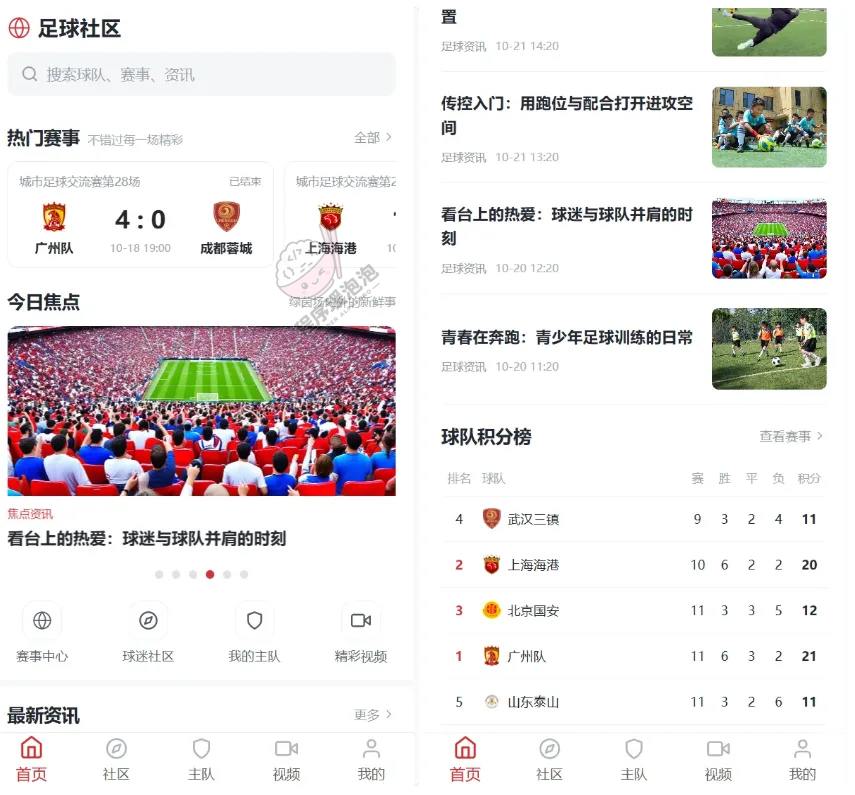
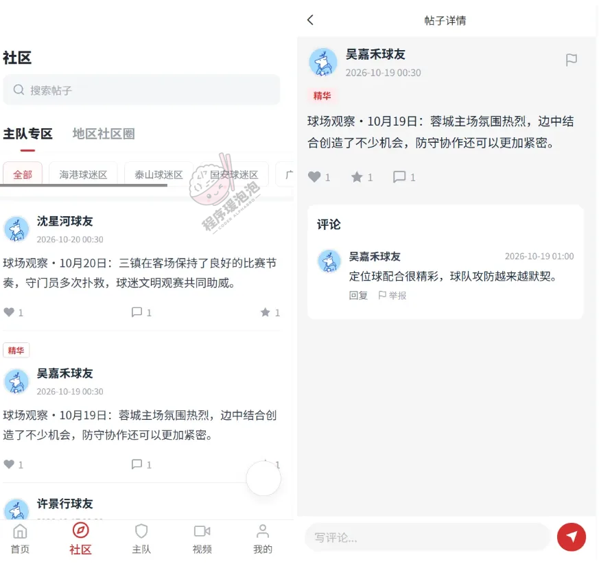
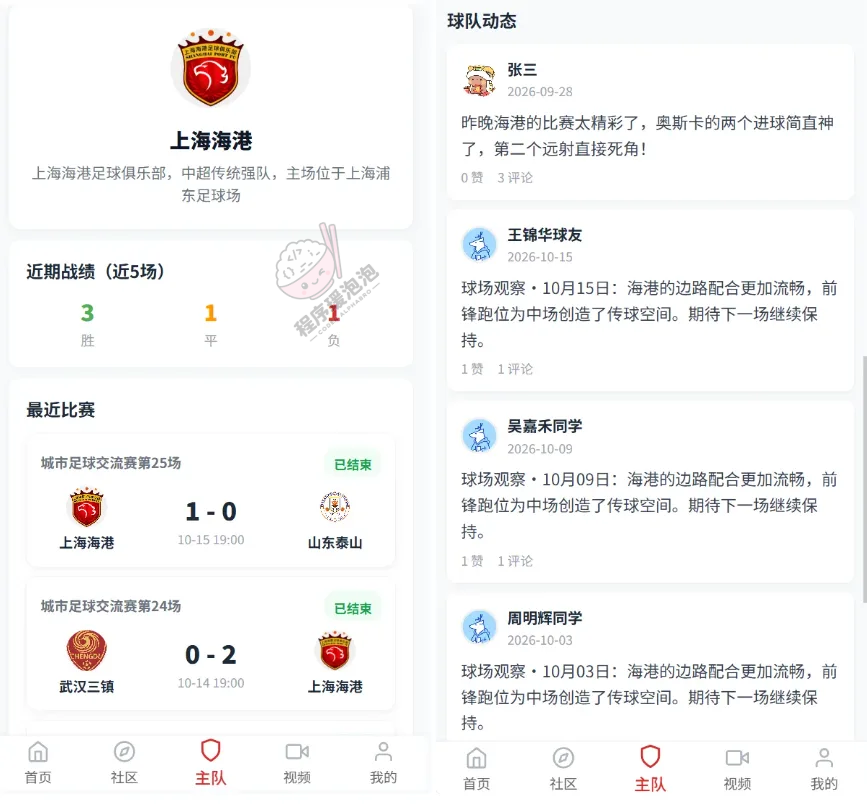
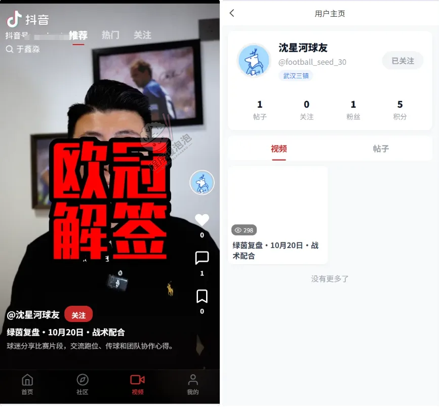
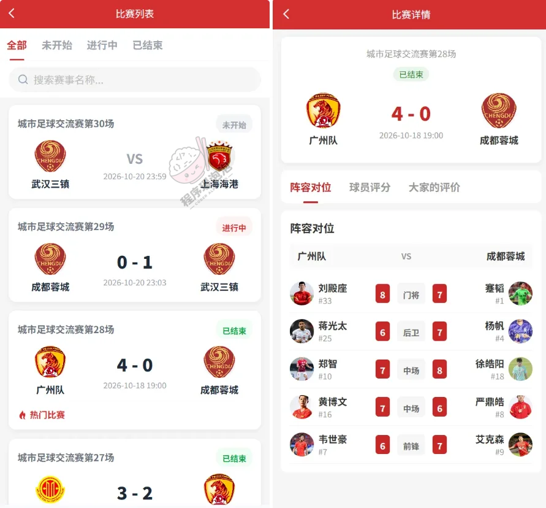
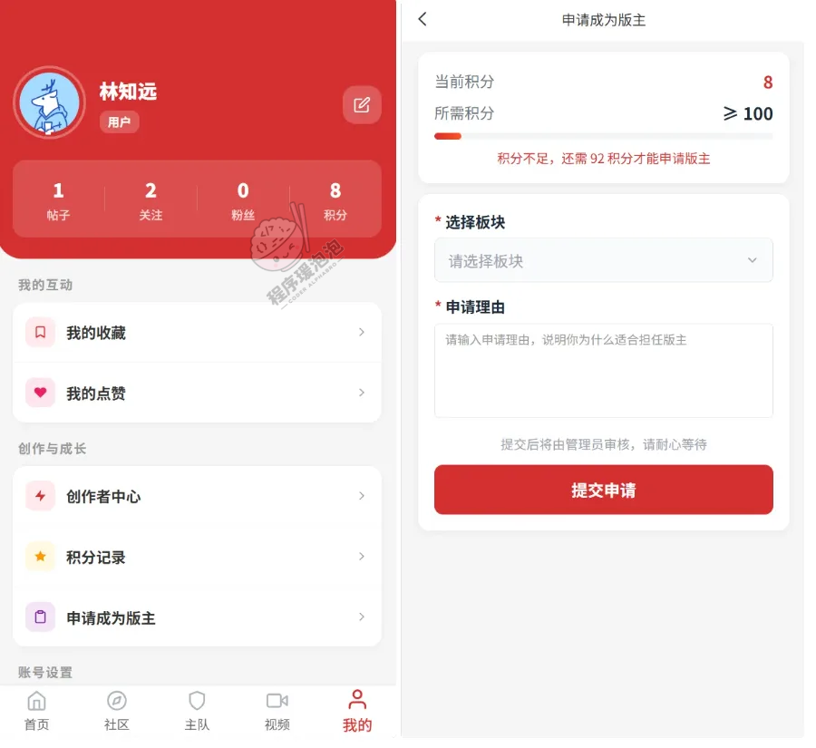
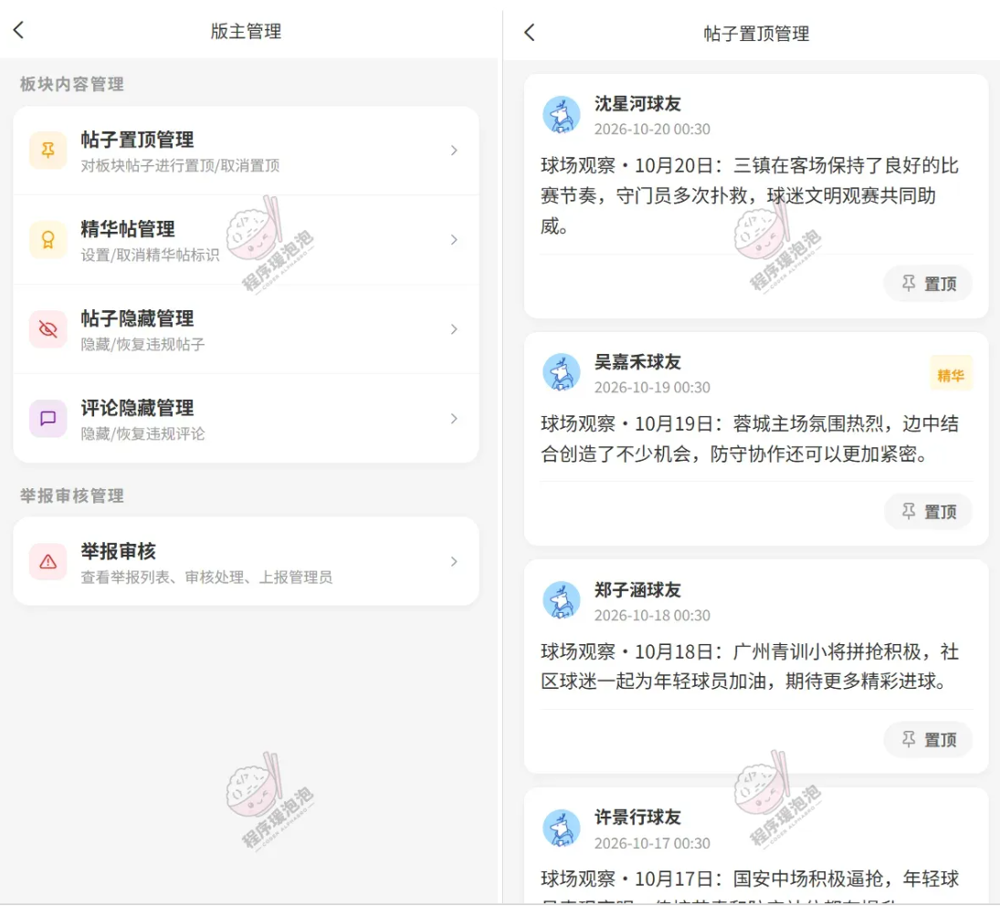
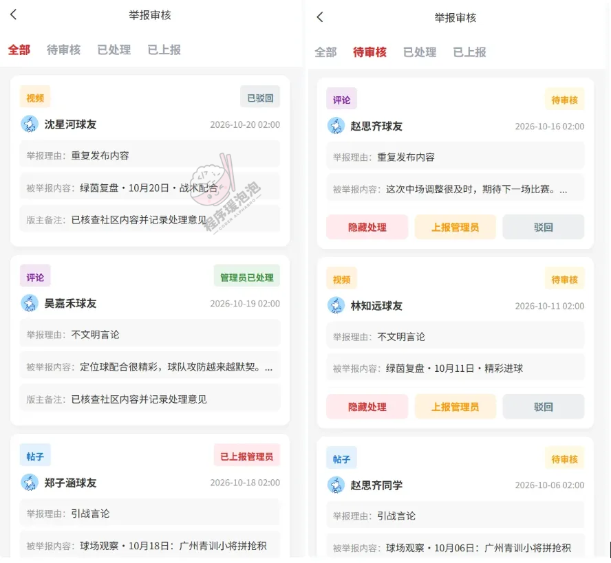
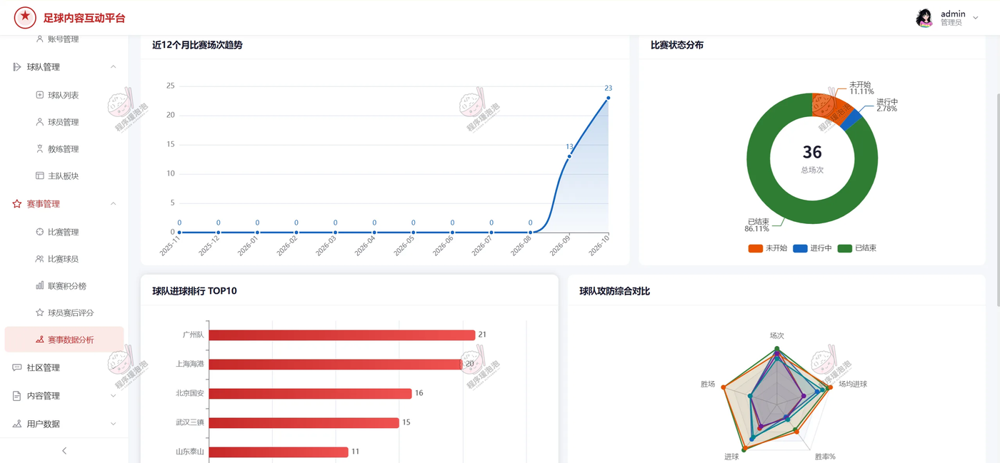
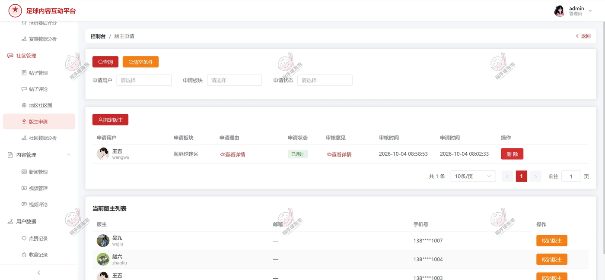

# FootballCommunityManagement
足球赛事与球迷社区小程序  可加ai功能，免费；
亮点：热门视频热度排序、联赛积分与排名计算、球员赛后评分汇总、社区分级治理、积分激励与版主申请、ECharts与中文词云；
角色：用户、版主、管理员； 

所有源码均本人开发，项目是前后端分离的，所有的项目都具备了完整的业务逻辑，不仅仅局限于基础的增删改查（CRUD）操作，系统亮点众多。

本文注重于计算机毕业设计选题指导，列出题目均有源码， 大家可以去【公众号】(毕业终点站)获取或者加我【qq】(2112698948)提意见(别忘记Star哟)。备注：git

声明：仅用于学习使用，请勿用于任何商业行为！

1.系统非商用，非开源，非无偿。

2.由本人开发，如需源码，请联系以下方式，qq:2112698948。 个人网站：https://home.biyecode.com

3.项目有很多，并未全部上传，如果未找到想要的，可直接咨询。

# 足球赛事与球迷社区小程序

> 基于 Spring Boot 3 + uni-app 的足球社区平台，微信小程序端 + 管理后台，管理员、普通用户、版主三种角色。
> 把赛事数据、球队积分、球员评分和球迷讨论放到一起，让看球、聊球和管球在同一处发生。

## 一、项目简介

这是一套面向球迷的足球内容社区。用户在小程序里看资讯和比赛、查主队战绩与积分榜、给球员赛后评分、发视频和帖子互动，还能攒积分申请版主；版主管理负责的板块、审核举报；管理员在后台维护球队赛事、审核内容与版主申请、看数据分析。

系统里几个花心思的地方：

- **热门视频热度排序**：综合点赞、评论、收藏和播放量加权计算热度，并引入发布时间衰减，让近期有互动的视频获得更多展示机会。
- **联赛积分与排名计算**：根据赛季内已结束比赛汇总胜平负、进球、失球和积分，依次按积分、净胜球、进球数排序，减少人工维护。
- **球员赛后评分汇总**：围绕具体比赛和出场球员收集球迷评分，计算平均分与分数区间分布，并同步更新球员的该场比赛评分。
- **社区分级治理**：从用户举报、版主核查到管理员复核形成处理流程，配合帖子置顶、精华及隐藏，兼顾球迷讨论和内容管理。
- **积分激励与版主申请**：发帖、获赞、被收藏、精华帖及每日登录可获得积分，申请版主时校验积分门槛，让日常互动与社区参与衔接。
- **ECharts 与中文词云**：展示用户增长、社区互动趋势、板块排行、球队胜率与进球表现；用 Jieba 分词、停用词过滤和词频统计呈现讨论热点。

## 二、技术栈

| 分层 | 技术 |
|---|---|
| 架构 | B/S、MVC、前后端分离，微信小程序端 + 管理后台，管理员 / 普通用户 / 版主三角色 |
| 后端 | Java、Spring Boot 3、Spring MVC、MyBatis-Plus、MySQL、JWT、微信小程序登录与账号绑定 |
| 后台 | Vue 3、Vite、Element Plus、Vue Router、Pinia、Axios、ECharts、SCSS |
| 小程序 | uni-app、Vue 3、Pinia、uni-ui 组件、微信小程序 API、SCSS |
| 环境 | Windows / IDEA / JDK 17 / Maven / MySQL / Node.js / HBuilderX / 微信开发者工具 |

## 三、系统功能

### 3.1 用户端
- 账号与个人中心：注册登录、微信登录与绑定、找回及修改密码、编辑资料、选择主队和地区
- 足球资讯与赛事：浏览新闻、比赛、球队、球员和教练信息，查看联赛积分榜、我的主队专区及近期战绩
- 球迷社区交流：在主队专区和地区社区圈发布图文帖子，搜索内容，点赞、收藏、评论及楼中楼回复，举报违规内容
- 视频与创作者中心：发布和管理视频，浏览播放、点赞收藏、发表评论、关注作者，查看粉丝、播放与互动数据
- 球员评分与成长：为已结束比赛的出场球员评分和评价，查看评分分布、积分记录、我的帖子、点赞、收藏、关注和粉丝

### 3.2 版主端
- 版主申请与板块管理：提交申请并查看审核结果，管理负责板块的帖子，设置置顶、精华和隐藏，处理违规评论
- 分级举报处理：核查所属板块举报，处理或驳回举报，将需进一步处理的内容上报管理员

### 3.3 管理员端
- 用户与版主管理：维护用户资料、封禁与解封、重置密码、审核版主申请、指定与取消版主
- 足球基础资料管理：维护球队、球员、教练、主队板块和地区社区圈
- 赛事与积分榜管理：维护比赛时间、主客队、比分、出场球员及赛后评分，按赛季重新统计联赛积分榜
- 内容与举报管理：发布足球新闻，管理帖子、评论和视频，审核视频，复核版主上报的举报
- 数据看板与分析：首页运营看板、社区统计、赛事统计，查看用户增长、内容趋势、板块活跃度、球队表现及举报分布

## 四、系统截图

以下选取 10 张代表性截图，按三个角色分别展示。源文档首图为后台登录入口页，未提供独立的系统总览图。小程序端截图为左右两页拼接的双屏图，按整张全宽展示。

### 4.1 用户端

**首页与积分榜** —— 左页展示热门赛事比分、今日焦点轮播和最新资讯；右页是资讯列表与球队积分榜，按排名列出赛、胜、平、负和积分，对应联赛积分与排名计算。

**球迷社区** —— 左页是主队专区和地区社区圈的帖子列表，含精华标签与点赞收藏评论；右页是帖子详情、楼中楼评论回复与举报入口，对应社区互动与治理。

**我的主队** —— 左页展示球队介绍、近 5 场胜平负战绩和最近比赛比分；右页是球队动态列表，球迷围绕比赛发表看法。

**精彩视频** —— 左页是视频播放页，可切换推荐、热门、关注，进行点赞评论收藏；右页是创作者用户主页，展示帖子、关注、粉丝和积分，对应热门视频热度排序。

**比赛与球员评分** —— 左页按未开始、进行中、已结束查看比赛列表；右页是比赛详情，在阵容对位、球员评分、大家评价之间切换，球员卡片展示号码、位置和评分。

**个人中心与版主申请** —— 左页是个人中心，统计帖子、关注、粉丝、积分，提供积分记录与申请成为版主入口；右页是申请表单，校验当前积分与 ≥100 的门槛，积分不足时给出提示。

### 4.2 版主端

**版主管理** —— 左页是版主管理入口，含帖子置顶、精华、隐藏、评论隐藏和举报审核；右页是帖子置顶管理列表，版主可对负责板块的帖子执行置顶操作。

**举报审核** —— 按全部、待审核、已处理、已上报查看举报，展示举报理由、被举报内容、版主备注，可执行隐藏处理、上报管理员或驳回，对应社区分级治理。

### 4.3 管理员端

**赛事数据分析** —— 近 12 个月比赛场次趋势折线图、比赛状态分布环形图、球队进球排行 TOP10 柱状图与球队攻防对比雷达图，对应 ECharts 数据可视化。

**版主申请审核** —— 按用户、板块和申请状态筛选版主申请，查看详情并审核，下方是当前版主列表，可取消版主，与用户端的申请成为版主形成对应。

---

文档展示 10 张截图，需要了解更多，请联系我。
